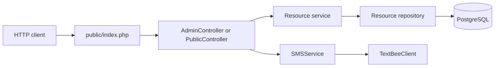

# Architecture and code responsibilities

Reviewed against `17dfae5`. The current app is native PHP with PDO and PostgreSQL, without a framework, autoloader or separate router class.

## Request lifecycle

1. The entry point sets the JSON content-type header and requires controller, service, repository, connection and TextBee files.
2. Connection::getConnection reads the root INI-style .env and opens a PDO PostgreSQL connection. Emulated prepares are disabled.
3. The entry point reads REQUEST_METHOD and the full REQUEST_URI, chooses the /api/admin/ or /api/public/ namespace and constructs a controller.
4. A controller matches the path, casts detail IDs to integers, invokes a service and JSON-encodes its result.
5. Services delegate retrieval to repositories and set a 404 response when a requested record is absent.
6. Repositories use PDO prepared statements and return associative arrays or false for a missing row.

Connection creation happens before namespace dispatch. Even the health route depends on initial database connectivity. The current connection class logs a PDO exception and terminates with plain text on failure; setting a JSON content-type header does not guarantee every failure body is valid JSON.

## Folder map

| Folder / file | Current responsibility |
| --- | --- |
| public/index.php | Bootstrap, connection, namespace dispatch and response header |
| src/controllers/ | Method/path matching and JSON output |
| src/services/ | Resource retrieval coordination, missing-record behavior and SMS delegation |
| src/repositories/ | Prepared SELECT queries and associative-array fetches |
| src/db/db.php | Local configuration and PDO connection |
| src/integrations/textbeeClient.php | cURL requests for gateway statistics/devices |
| src/integrations/emailJSClient.php | Standalone sendEmail client foundation |
| src/entities/ | Claim, Item and LostReport constructor-based classes |
| sql/ | Schema, sample SQL and a short schema outline |
| docs/ | Documentation maintained on the dedicated documentation branch |

## Entity and integration status

The latest refactor adds Claim, Item and LostReport classes with private properties and constructors. They have no public accessors or serialization interface. The current entry point does not require them and repositories still return arrays; the retrieval response does not pass through these entity objects.

EmailJSClient reads service/template/public-key configuration, builds a JSON POST and calls a configured base URL plus /api/v1.0/email/send. It is not required or called by the current entry point, controllers or services.

Do not describe these files as completed claim creation, item registration, report submission or email notification workflows. Matching, photo handling, cancellation and the frontend are also not implemented in the inspected request flow.

## Development boundaries

Keep future HTTP handling in controllers, coordination in services and SQL in repositories, following the lead's agreed conventions. Coordinate schema or architecture changes with the lead. This documentation branch changes no PHP or SQL.

For the exact implemented paths and ID conversion behavior, see [API reference](api.md). For constraints the code must respect, see [database reference](database.md).

